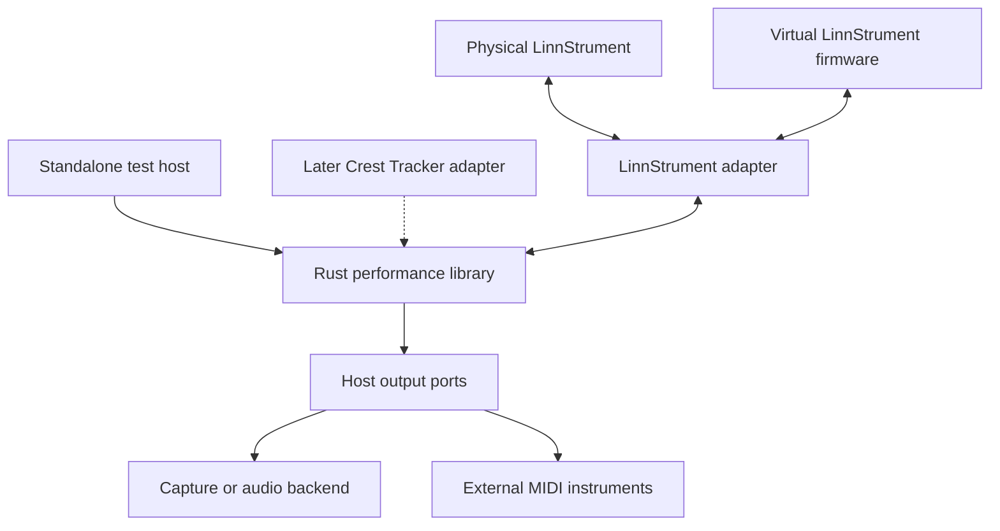

Build a standalone, reusable Rust performance library for a LinnStrument groovebox, then integrate it into Crest Tracker. The library starts in its own repository with its own test host, simulator, CI and releases, so it can develop independently while Crest Tracker progresses in parallel. The eventual groovebox runs on a Steam Deck. Crest Tracker continues to contain the Crest Synth engine, with sound generation kept behind its MIDI receiving boundary.

The development environment must include an interactive, firmware-driven replica of the LinnStrument in a desktop webview using the same framework approach as Crest Tracker. It displays the instrument, accepts mouse, keyboard and scripted multi-finger input, and renders actual firmware LED output. Independent per-note MPE expression and hardware-free development are release requirements.

The first playable milestone runs entirely in the standalone test host: record an expressive phrase from the virtual LinnStrument, loop it, and launch it from virtual pads with correct light feedback. A MIDI capture sink provides deterministic verification; an optional reference instrument provides sound. Crest Tracker integration follows a versioned library baseline. Orchid-style harmony, OXI-style accompaniment and further performance features can continue developing in the library while that integration proceeds.

Status: proposed implementation plan, revised October 16, 2026, Pacific time. The Rust library and simulator are new work. The current Crest Tracker uses a webview approach, as specified by the project owner; match its actual webview shell and frontend framework for the simulator. Confirm those package names and versions before implementing the visual shell. The older public Godot/C# scaffold does not establish the working architecture. The standalone core and firmware work remain independent of Crest Tracker source availability.

# Product scope

The normal workflow is play, capture, loop, launch, and develop. The Deck’s controls handle navigation, sound browsing, and detailed editing. The LinnStrument alternates between expressive playing, harmony controls, and clip launching.

| Delivery | Capabilities |
| - | - |
| Standalone library baseline | Virtual firmware device, expressive note input, polyphonic MIDI clip recording and playback, one clip bank, launch and stop with LEDs, session save and reopen, a standalone test host and MIDI capture sink. Optional reference audio for auditioning. |
| Library expansion | Record and overdub, retrospective capture, clip duplication and undo, launch quantization, piano-roll edit commands, scale and harmony modes, multiple routes and clock control. These develop independently of Crest Tracker. |
| Crest Tracker integration | Consume a versioned library release; connect the embedded Crest Synth engine, sample instruments, production UI, project persistence and tracker interoperability. |
| Integrated groovebox | Controller-driven Steam Deck workflow with expressive playing, samples, internal and external tracks, clip launching and LinnStrument feedback. |
| Further expansion | Bounded generative patterns, Euclidean rhythms, conditional events, parameter locks, scene morphing, sample slicing, granular playback and resampling. |

A chord remains in one polyphonic clip. Expressive timing survives recording and editing; quantization is optional. The initial scope does not require a full arrangement editor, a new plugin host, or a rewrite of Crest Synth’s DSP. The library produces musical events and instrument references. Production sound-engine extensions needed for samples or MPE belong in the existing embedded Crest Synth engine during integration; they do not block the standalone library.

# Rust library architecture

Use the provisional repository and package name `crest-performance`. Create it as an independent Rust workspace, not as a subdirectory or internal module of Crest Tracker. The library owns musical behavior and device integration. A small standalone host exercises its public API without importing any Crest Tracker code. Later, Crest Tracker becomes another consumer and owns its application UI, audio hosting and project integration.

| Package or target | Responsibility |
| - | - |
| `crest-performance-core` | Deterministic event model, transport, recording, clips, harmony, generators, routing decisions and performance state. |
| `crest-linnstrument` | MIDI parsing, normal/MPE and User Firmware Mode handling, device capabilities, grid modes, LED rendering and reconnect state. |
| `crest-performance-host` | Standalone example and test application: transport, clip grid, basic editing, routing, session files, MIDI capture and optional reference audio. Uses only the library’s public API. |
| `crest-performance-testkit` | Scripted inputs, virtual clock, trace collection, assertions and deterministic regression fixtures. |
| `linnstrument-sim` | Standalone desktop webview showing the LinnStrument, with mouse/keyboard contact controls, optional diagnostics, a Rust bridge and a separate C++ worker executing pinned upstream firmware. Match Crest Tracker’s webview and frontend stack without importing its application. |
| `crest-performance-ffi` | Versioned C ABI for non-Rust consumers, introduced when required by integration. Crest-specific language wrappers live with the consuming application. |

Start with a small workspace; split additional crates only when dependency boundaries justify it. Keep MIDI device access, file operations, audio backends and GUI frameworks outside the deterministic core. The production library must build without the C++ simulator or its toolchain, and all standalone targets must build without checking out Crest Tracker.

The public host interface supports creating an engine, applying commands, accepting timestamped input, advancing musical time, draining scheduled output, reading UI state, and saving or restoring a versioned library session. Define time units, event ordering, ownership, errors and capability negotiation in that contract. Rust hosts consume an `rlib`. The simulator’s webview sends contact and control commands through a typed native bridge and receives display snapshots. During Crest Tracker integration, select a direct Rust dependency or a C ABI according to its actual native backend; sharing a frontend framework does not require sharing application internals.

Use explicit C-compatible structures, opaque handles, documented buffer ownership and ABI version negotiation. No Rust collections, exceptions, or panics cross the ABI. Batch musical events; deliver display snapshots separately from real-time data.

## Independent delivery and parallel development

The library repository owns its source, simulator integration, example host, documentation, tests and releases. Crest Tracker stays in its own repository and consumes a tagged release or pinned commit. A local path override may speed joint development, but normal builds and CI must work from the declared dependency without a sibling checkout.

The standalone host and the later Crest Tracker adapter use the same commands, event streams, clock interface, UI snapshots and session schema. Do not expose Crest-specific scene objects, tracker documents, GUI types or sound-engine internals in the library API. Use contract fixtures to check equivalent behavior across hosts.

Maintain independent CI and release schedules. Tag the M3 baseline as the first integration candidate, provisionally v0.1. Document API, ABI and persistence versions and compatibility rules, including explicit breaking changes while versions are below 1.0. Crest Tracker can pin a known version while the library advances; upgrades are deliberate changes validated by the shared fixtures.

The standalone host is a development and demonstration application, not a second production DAW. Mandatory headless tests use a MIDI/event capture sink. Optional reference audio is a replaceable host backend and does not establish a dependency on Crest Synth or require duplicating its production DSP.

# Runtime architecture and later integration

Both physical and virtual devices use the same LinnStrument adapter and MIDI semantics. The emulator may use an in-process or local transport for tests; an OS virtual MIDI port lets the standalone host, ordinary MIDI tools and later Crest Tracker connect to it interactively. In the standalone host, output ports connect to capture sinks and optional reference audio. During integration, Crest Tracker connects those ports to its embedded Crest Synth engine and external MIDI transport.

The active host supplies the authoritative clock through a generic interface. The standalone host supplies its own clock, and tests advance a virtual clock deterministically. After integration, Crest Tracker supplies its audio/MIDI timing service. Production scheduling must not follow the render-frame rate. Internal destinations receive timestamped events at the sound engine’s scheduling boundary; external MIDI destinations use the host’s MIDI transport.

Keep the sound-generation boundary intact: backends receive notes, expression and supported parameter messages; they do not manage clip slots, harmony leaders, LinnStrument modes or LEDs. The host loads sample assets and sound presets; the Rust library stores instrument references and controls musical behavior. For Crest Tracker integration, adapt this boundary to its embedded Crest Synth engine and confirm or add per-note expression support before claiming MPE audio playback. Standalone event-level verification remains independent of that engine work.

Support one clock authority at a time: local host clock or an external MIDI clock source such as the OXI. Define start, continue, stop, position changes and clock-loss behavior, and prevent MIDI routing feedback loops.

# Musical event and clip model

Use stable note identities independent of MIDI channel numbers. An event identifies its source, track, note and timestamp. Per-note pitch, pressure and timbre curves remain associated with that note through recording, editing and playback.

Store musical positions with enough precision for unquantized performances and fine subdivisions. Choose a documented fixed-point beat or high-resolution tick representation in the foundation milestone; adapt existing tracker ticks at the host boundary. Convert to sample positions only when scheduling sound output.

The minimum domain objects are Session, Track, Clip, Note, ExpressionCurve, InstrumentTarget, ClipSlot, HarmonySource, PerformanceSnapshot and SurfaceLayout. Define a versioned library session schema independent of Crest Tracker’s document model. The standalone host saves it in a simple session file. During integration, Crest Tracker embeds or references this state within its existing project and maps tracker data through an adapter; the library must not require a Crest Tracker song document.

A clip stores notes, durations, expression, loop boundaries and optional parameter events. Generated material also records its input gestures or harmonic intent, transformation settings, random seed and algorithm version, plus the rendered MIDI performance needed for exact musical replay. Raw performance data is authoritative; optional compression must have a defined error bound.

The event model must support both piano-roll and tracker views. The standalone host proves basic selection and editing through public commands; the production tracker view is an integration task. Opening a free-timing performance in that view must not silently quantize it or discard expression. Represent off-grid events and polyphony explicitly, with a clearly chosen destructive quantization operation when desired.

Allocate MIDI 1.0 MPE channels at each output destination. Never replay captured channel numbers blindly: a live note and a clip note may otherwise share a channel and interfere. Specify output-zone capacity, voice stealing or rejection, pitch-bend range setup, sustain, channel reset and note-off ordering. Internal tracks may have more voices than a particular external MIDI zone; expose that limit per destination.

# Virtual LinnStrument strategy

The required deliverable runs the actual LinnStrument C++ firmware logic. Its normal visual playing path must traverse the emulated sensor interface, upstream touch interpretation and upstream MIDI generation. A firmware process merely running alongside a JavaScript or Rust MIDI generator does not satisfy this requirement. Protocol test doubles remain useful for isolated tests and must be visibly distinct from the firmware-backed replica.

The recommended first implementation is a native desktop firmware build with emulated Arduino and peripheral services. This reuses the upstream source, including its setup and loop routines, touch interpretation, MPE allocation, settings, MIDI parser and LED behavior. It is source-level hardware simulation, not execution of the identical ARM firmware binary.

| Fidelity level | Purpose | Completion criterion |
| - | - | - |
| Protocol test double | Fast library tests and fault injection. | Exercises the adapter without needing the firmware; never presented as firmware validation. |
| Native firmware simulator | Required desktop and CI development environment. | Compiles and executes the upstream firmware with emulated hardware, runs normal and user modes, and emits observable MIDI and LED output. |
| ARM binary emulator | Separate feasibility task for cases that require the original compiled image. | Boots the matching ARM image on an implemented SAM3X/Due board model with the required peripherals; CPU support alone is insufficient. |
| Physical comparison | Establish hardware fidelity when a unit is available. | Compare controlled MIDI, settings and LED scenarios; separately measure sensor behavior and latency. |

The upstream repository identifies Arduino Due and an older Arduino IDE/SAM-core build baseline. The inspected code accesses sensors and LEDs over SPI, persists settings in flash, handles MIDI through Serial, and performs background tasks inside microsecond delay loops. These are concrete emulator requirements.

Do not assume a generic QEMU ARM machine can boot this firmware. QEMU’s documentation requires a matching board model. During the feasibility task, check QEMU and Renode board support and estimate missing SAM3X peripherals before choosing binary emulation. The native firmware target remains a required milestone even if binary emulation proves disproportionately large.

References: [upstream README](https://github.com/rogerlinndesign/linnstrument-firmware/blob/54bb1c9d355b1075b474ade0a0246b80ff7f3524/README.md), [firmware sensor code](https://github.com/rogerlinndesign/linnstrument-firmware/blob/54bb1c9d355b1075b474ade0a0246b80ff7f3524/ls_sensor.ino), [firmware timing code](https://github.com/rogerlinndesign/linnstrument-firmware/blob/54bb1c9d355b1075b474ade0a0246b80ff7f3524/ls_rtos.ino), [QEMU board requirements](https://www.qemu.org/docs/master/system/target-arm.html).

# Firmware source and hardware emulation

Clone [rogerlinndesign/linnstrument-firmware](https://github.com/rogerlinndesign/linnstrument-firmware) into a pinned third-party dependency. The inspected baseline is commit `54bb1c9d355b1075b474ade0a0246b80ff7f3524`. Retain an unmodified upstream reference and a small, reviewable patch series for desktop portability. Keep hardware feature changes in a separate branch. The initial physical-device target is stock firmware.

Preserve upstream license and attribution files and record dependency versions. Reproduce the ARM build before adding the desktop target. Generate the sketch translation unit and prototypes reproducibly so Arduino preprocessing is not an undocumented dependency.

| Boundary | Required emulation |
| - | - |
| Clock and delays | Deterministic microsecond time, documented execution and bus costs, timer wraparound, and progress during busy polling. A frozen clock would deadlock existing delay loops. |
| Sensor matrix and ADC | Decode sensor-selection SPI transactions and supply ADC responses from synthetic raw X/Y/Z surfaces. Preserve upstream calibration and touch processing. |
| Contact model | Convert virtual fingers into sensor-cell readings, including overlap during slides. Supply repeatable calibration fixtures and distinguish synthetic contacts from measured physical sensor data. |
| LEDs | Decode LED SPI writes and output-enable behavior into an RGB frame, including multiplexed brightness and blinking. Render firmware output, not the application’s intended colors. |
| Serial MIDI | Bidirectional bytes, bounded FIFOs, backpressure, running status and real-time messages. Model the board-side serial path separately from the host’s MIDI API. |
| Flash and settings | Deterministic persistent images, erased-state behavior, calibration, reset and versioned fixtures. |
| Pins and switches | Model identity, panel/control column, foot switches, routing and reset behavior. |
| Platform semantics | Audit ARM intrinsics, 32-bit time and arithmetic, alignment, packing and flash layouts. Desktop `long` and struct sizes must not silently change firmware behavior. |

Substitute at Arduino and peripheral boundaries. Mouse, keyboard, touch and scenario inputs all create virtual contacts that the sensor model converts to raw readings consumed by upstream firmware. Do not map a pad click directly to Note On, or an X/Y/Z control directly to MIDI, in the normal replica path. A temporary high-level injection hook may speed debugging, but fidelity acceptance must exercise the firmware’s sensor and touch path. Keep unsupported behavior explicit rather than returning success from unimplemented hardware calls.

Run the firmware in a separate worker process initially. Its global state can reset cleanly without entering the audio thread, and a crash produces a trace rather than taking down the host. A webview frontend sends contact and simulator-control commands to a Rust bridge; the C++ worker returns emitted MIDI bytes, decoded LED frames and diagnostics. The native scheduler owns emulated time and peripheral execution. Browser animation frames only render snapshots and must not determine sensor scanning or musical timing.

Firmware execution can validate software behavior. It cannot by itself establish the real sensor’s noise, tactile response, physical scanning latency, USB electrical behavior or calibration accuracy.

# Interactive webview LinnStrument

Build a standalone desktop application whose default view is the LinnStrument itself: the 200-pad or 128-pad surface, control column, firmware colors and active contact markers. Match the current Crest Tracker webview shell, frontend framework and UI conventions, while keeping this application in the library repository with its own entry point, dependency manifest and build. Exact framework names and versions must be confirmed from the working project rather than guessed from the old scaffold. The default surface needs no tracker, sequencer or clip editor; the separate example host supplies those views.

Provide usable controls for every expressive dimension even with an ordinary mouse and keyboard. All controls operate on virtual contacts before firmware processing. Render contact markers as a distinct optional overlay so a simulated finger cannot be mistaken for a firmware LED.

| Input | Virtual instrument behavior |
| - | - |
| Mouse press and release | Place and release a contact at a continuous surface position, with configurable initial pressure and attack/release profiles. |
| Mouse drag | Move that contact continuously in X and Y, including across cell boundaries; let the firmware decide pitch, slides and retrigger behavior. |
| Pressure control | Wheel, assignable keys and a selected-contact slider change Z pressure; a mouse is not treated as a pressure sensor. |
| Keyboard | Configurable pad shortcuts and press/release controls; WASD or arrow controls move the selected contact, with separate pressure keys and coarse/fine adjustment. Suppress OS key repeat as a source of unintended note retriggers. |
| Multiple virtual fingers | Add, latch, select, move and release contacts independently while the others remain held. Support simultaneous keyboard contacts and scripted continuous gestures on several contacts. |
| Touch or stylus | Use independent pointer IDs and real pressure only when exposed by the device; otherwise use the same explicit pressure controls. |
| Recovery | Release momentary contacts on lost pointer capture or focus; show latched contacts clearly and provide Release All and reset controls. |

## Firmware execution and feedback

The forward path is webview gesture, virtual contact state, synthetic sensor readings, upstream firmware, emitted MIDI, and the shared LinnStrument adapter. Instrument the boundaries so a scenario can prove that its MIDI came from firmware. If the worker stops, mark the device disconnected and stop accepting performance input; never silently switch to a mock generator.

The return path sends host LED/configuration MIDI through the firmware’s input parser, executes its display logic, decodes its LED writes, and renders that output in the webview. The application’s requested colors are not the displayed truth. The virtual control column must exercise the firmware’s own settings and mode UI, including timed holds; avoid a separate imitation of those settings.

Use the same contact model, worker and scheduler for visual and headless runs. Timestamp gestures at the native bridge and document resampling and interpolation into sensor updates. A responsive frontend must not bypass the sensor model or change firmware behavior to feel smoother.

## Optional MPE inspector

Keep the default window focused on the instrument. A collapsible inspector shows selected contact X/Y/Z, raw sensor readings, firmware MIDI bytes, member channel, note, pitch bend, timbre and pressure, plus the firmware revision and configuration. Plot expression over time per note and distinguish input-channel allocation from the library’s output allocation. Capture and replay a manual gesture session as a regression fixture.

Allow pause, single-step, real-time operation, accelerated test execution, reset and deterministic replay. Each run records the firmware commit and patch hash, simulator version, device geometry, flash fixture, MPE zone and bend-range configuration, seed, timestamped gesture input, MIDI trace and LED frames. Replay gestures through the same sensor and firmware path used interactively.

Proposed scenario primitives are boot, set contact, move contact, release contact, send MIDI, advance time, assert MIDI, assert LEDs and reboot with persisted settings. These are proposed interfaces, not commands available today.

The standard standalone demonstration starts the virtual device and test host, plays scripted expressive notes, records a clip, changes to clip mode and launches it from a virtual pad. It captures playback events and firmware LED output, with optional sound through a reference instrument. No Crest Tracker checkout, physical LinnStrument or external synth is required. After integration, run the same scenario through Crest Tracker and its embedded engine using the shared acceptance fixtures.

# MPE correctness as a release gate

MPE is a primary acceptance criterion from M1 onward. A working grid and ordinary polyphonic notes are insufficient. In the standard LinnStrument MPE profile, X motion uses per-note pitch bend, Y uses CC74 and pressure uses Channel Pressure on member channels. Configure and record the selected firmware profile explicitly; do not silently substitute One Channel or Channel Per Row behavior. See [Roger Linn’s MPE explanation](https://www.rogerlinndesign.com/support/support-linnstrument-what-is-mpe) and [LinnStrument MIDI modes and mappings](https://www.rogerlinndesign.com/support/support-linnstrument-linnstruments-smart-midi).

Verify three separate boundaries: raw firmware MIDI, the Rust library’s note/expression model, and scheduled output after transformation or clip playback. This separates firmware or sensor-model errors from adapter, recorder and output-allocation errors. Use independently specified expectations with tolerances derived from the configured MIDI resolution and firmware filtering, not only a comparison of two traces produced by the same implementation.

| Scenario | Required evidence |
| - | - |
| Independent expression | Hold at least three contacts. Bend A, move B vertically and change C’s pressure; only the intended notes’ corresponding expression changes. Repeat with all dimensions moving concurrently. |
| Continuous movement | Small vibrato, slow movement and long slides across adjacent cells retain the firmware’s documented note ownership and configured quantization behavior. Y and pressure remain independently observable during a slide. |
| Note lifecycle | Different attack/release profiles, repeated pitches on different pads, overlapping releases and sustained notes preserve ownership and generate the appropriate release events. |
| MPE configuration | Verify member/main channel separation, supported split-zone profiles and matched pitch-bend ranges. Detect an incompatible destination configuration instead of judging pitch by raw bend values alone. |
| Capacity and reuse | At and beyond the configured member-channel capacity, assert the pinned firmware’s behavior separately from the library’s output policy. Reused output channels must not inherit a previous note’s bend or pressure. |
| Recording and playback | Record simultaneous X/Y/Z curves, save and reopen, then replay with live MPE notes alongside the clip. Expression stays with its note, even when output channel numbers differ from the recording. |
| Harmony | In M4, verify the declared gesture-to-chord-voice expression policy and release every generated voice; expression must not leak to unrelated live or recorded notes. |
| User mode transitions | Verify stock MPE playing before and after custom control mode. Test user-mode coordinate handling separately; it does not prove the stock MPE generation path works. |
| End-to-end UI | Real mouse and keyboard actions in the webview reach the worker, produce expected firmware MIDI and display firmware LED changes. A drawn pad animation alone cannot pass this test. |

M1 must pass independent expression directly at firmware output; M2 must pass it through the library; M3 must preserve it through recording and playback. An optional reference instrument can help audition the results, but MIDI/event assertions remain mandatory. M6 additionally requires audible, per-note expression through the actual embedded Crest Synth engine and an MPE-responsive patch. Event-only tests do not establish correct sound-engine behavior.

# LinnStrument modes and feedback

Start with explicit Play, Chords and Clips modes. Display the active mode in the standalone host, and later in Crest Tracker on the Deck, with an immediate return to ordinary playing.

Stock User Firmware Mode exposes cell coordinates and programmable feedback but disables normal firmware playing features. The initial design therefore switches between standard MPE playing and a custom control mode. Do not assume stock firmware provides simultaneous arbitrary custom pad zones and unchanged normal MPE behavior.

For a later mixed playing and clip surface, evaluate three implementations: supported stock split/channel configurations, interpreting user-mode touch data in the Rust library, or a minimal firmware extension. Select only after proving slides, touch identity and expression behave correctly. The native simulator must be able to run both stock and patched firmware for comparison.

LED feedback covers roots and scale notes, chord tones, selected tracks, active notes and clip states: empty, recorded, queued, recording, overdubbing and playing. Use a frame diff, ordered coordinate/color commands and a bounded update rate. Keep LED traffic from delaying musical output.

On mode change, release affected notes, reset expression ownership and restore the correct lights. On reconnect or emulator restart, read or reapply configuration and repaint the grid. Use a recovery path that returns the device to ordinary performance mode when a session ends.

Reference: [LinnStrument User Firmware Mode](https://github.com/rogerlinndesign/linnstrument-firmware/blob/54bb1c9d355b1075b474ade0a0246b80ff7f3524/user_firmware_mode.md).

# Feature backlog

| Feature | Implementation goal | Priority |
| - | - | - |
| Expressive clip recording | Polyphonic notes and full per-note expression; overdub, replace, undo and explicit loop-end note policies. | Core |
| Retrospective capture | Recover the previous phrase from a bounded event buffer, retaining expression. | Core |
| Clip launcher | Quantized launch/stop, independent loop lengths, duplicate, clear, mute/solo and coordinated scene launch. | Core |
| Scale mode | Highlighting, in-scale layouts, chromatic override and independent bend-quantization choice. | Core |
| Diatonic chord mode | Scale-degree pads with quality, extension and borrowed-chord modifiers; show resulting notes. | Harmony |
| Voicing and bass | Inversions, spread, register, optional minimal-motion voice leading, fixed bass or routed root/bass part. | Harmony |
| Custom chord capture | Learn a played voicing and assign it to a pad or chord bank. | Harmony |
| Chord articulation | Strum, humanized timing, arpeggio, fixed rhythmic patterns and harp sweeps. | Harmony |
| Expressive chord control | Route one gesture to all generated voices, the top voice, or chosen parameters; maintain stable voice identity. | Harmony |
| Harmony followers | Bass or melody clips follow a live chord source or chord clip while preserving their rhythm. | Performance |
| Reharmonizable clips | Optional relative scale/chord representation, with a preserved fixed-pitch rendered version. | Performance |
| Temporary changes | Hold for repeat, fill, octave shift or displacement; release restores state, explicit commit keeps the result. | Performance |
| Generative accompaniment | Seeded probability, bounded pitch/rhythm changes, Euclidean patterns and capture/freeze. | Expansion |
| Parameter events | Per-event parameter settings, conditional playback and recorded macro changes. | Expansion |
| Performance snapshots | Morph selected sound parameters between two states; distinguish these from clip-launch scenes. | Expansion |
| Sample performance | Pitched samples and drum kits first; slices, position control, granular textures and resampling later. | Core then expansion |

Orchid supplies the key-mode, voicing and articulation references; OXI supplies the harmony-following and controlled-generation references. Borrow the interaction concepts and implement original code.

Sources: [Orchid Key Mode](https://support.telepathicinstruments.com/hc/en-us/articles/15280829123087-How-to-Use-Key-Mode-for-Easy-Chord-Progressions), [Orchid voicings](https://support.telepathicinstruments.com/hc/en-us/articles/15292199149839-Voicing-Engine-and-Inversions), [Orchid performance modes](https://support.telepathicinstruments.com/hc/en-us/articles/15280943220367-Exploring-Performance-Modes-Arp-Strum-Pattern-and-More), [OXI ONE MKII](https://oxiinstruments.com/oxi-one-mkii), [Ableton MIDI capture](https://www.ableton.com/en/live-manual/12/recording-new-clips/), [Elektron event conditions](https://www.elektron.se/wp-content/uploads/2025/07/Digitakt-2-User-Manual_ENG_OS1.15A_250708.pdf), [Octatrack scenes](https://www.elektron.se/wp-content/uploads/2024/09/Octatrack-User-Manual_ENG-OS1.40A_220204.pdf).

# Implementation milestones

## M0 Standalone repository and contracts

Create the independent Rust workspace, headless runner, minimal test-host shell and CI. Define the event, clock, output, command, UI-state and persistence interfaces without importing Crest Tracker types. Prove the first public API call from the standalone host. Identify the current Crest Tracker webview shell and frontend dependencies from its manifest, and record the matching stack for the independent simulator frontend. Core and firmware tasks continue if those UI details are pending. In the firmware workstream, clone and pin upstream source, reproduce its ARM build and inventory hardware dependencies.

Deliver a buildable library and example host, a short public-contract specification, contact/bridge protocol, deterministic fixture format, firmware build recipe and native-versus-binary emulation feasibility assessment. The standalone library gate is a clean build and test run without Crest Tracker. Firmware baseline work gates M1, not core library progress. Only UI framework identification happens early; inspecting Crest Tracker’s application integration points and choosing its library binding remain M6 work.

## M1 Firmware driven webview replica

Implement the desktop sketch build, Arduino compatibility layer, serial/flash/pin shims, sensor SPI model, LED decoder and deterministic scheduler. Add ideal calibration fixtures for both device sizes. Build the firmware worker and headless scenario runner, then connect the standalone webview surface through the Rust bridge. Implement click, drag, keyboard control, independent latched contacts, pressure adjustment and actual firmware LED rendering.

Exit when the upstream firmware boots in the simulator, the visible control column and pads drive its real touch/settings path, and mouse or keyboard gestures produce observable firmware MIDI. The three-contact independent X/Y/Z test must pass at raw firmware output. Incoming LED commands must change the rendered firmware output, User Firmware Mode must enter and exit correctly, and replay must be deterministic. Run without hardware. A protocol mock, direct UI-to-MIDI generator or static visual grid does not close M1.

M1 is the primary feasibility gate. If portability requires changes to musical behavior, record the divergence and resolve it before declaring the firmware simulator authoritative. Use the binary-emulation investigation to settle target-specific behavior where necessary.

## M2 Expressive playing in the standalone host

Implement timestamped events, note identities, normal/MPE parsing, output allocation, transport, routing and the LinnStrument adapter. Connect the firmware simulator and a real MIDI transport implementation to the same adapter. The standalone host consumes these APIs and routes output to deterministic MIDI/event capture sinks, with an optional reference instrument for auditioning.

Exit when the MPE release-gate scenarios preserve independent note identities and expression through the public library API, including repeated pitches and independently moving virtual fingers. Route a separate part to another sink and verify independent destination allocation. Stop, disconnect and mode changes leave no held notes. Inspector traces distinguish firmware input from library output. The scenario runs without any Crest Tracker source, application or sound engine.

## M3 Standalone record and launch release

Implement clip persistence, recording, loop playback, overdub, retrospective capture, launch quantization, undo and clip-state events. Add a basic clip grid and minimal piano-roll selection/editing to the standalone reference host, with controller-accessible transport and launching. Connect virtual pads to clip launching and LEDs to actual clip state. Keep production Crest Tracker UI work for integration.

Exit when an expressive phrase can be played from the firmware-backed webview, captured, looped, launched and edited in the standalone host. The recorded per-note X/Y/Z curves must survive save/reopen and playback while new live MPE notes play alongside them without interference. Tag the first independently usable library release, provisionally v0.1, with documented APIs, example host, interactive simulator and acceptance fixtures. This is the baseline for later integration, not a requirement to finish the full feature backlog first.

## M4 Harmony performance

Add scale and chord banks, diatonic chords, modifiers, inversions, spread, bass routing, custom chord capture, voice leading and chord articulations. Define expression fan-out and voice ownership. Exercise a chord-selection and voicing layout in the standalone host. This work can continue in the library while Crest Tracker integrates the M3 release.

Exit when a short progression can be performed, captured and edited, including a separately routed bass part. A live voicing or scale change does not create stuck notes or unexpectedly retune unrelated sustained voices.

## M5 Connected performance tools

Add leader/follower harmony, relative-note clips, seeded generators, Euclidean rhythms, temporary transformations, parameter events and performance snapshots. Define sample-slice and expressive sample-position controls as backend capabilities and validate their event contracts with test sinks. Implement production sample DSP in the embedded engine during Crest Tracker development; expose only capabilities supported by the active backend.

Exit when a chord source drives an accompaniment, a generated take can be frozen and replayed, and a temporary transformation returns exactly to its prior musical state on release. Original and transformed performances remain recoverable.

## M6 Crest Tracker integration

Begin after the M3 standalone baseline is available; M4 and M5 may continue independently. Inspect the actual working Crest Tracker fork and map its transport, input, project persistence and sound-engine event APIs. Confirm the host language and choose a direct Rust dependency or versioned C ABI plus a thin host wrapper.

Consume a tagged library release or pinned commit. Implement the Crest Tracker adapter, connect its embedded Crest Synth engine, production clip and piano-roll UI, tracker interoperability, project storage and MIDI routing. Keep host-specific mappings in Crest Tracker rather than introducing a reverse dependency into the library.

Identify and implement any missing sample playback or per-note expression capabilities in the existing engine. Run the same input scenarios and contract fixtures used by the standalone host. Compare scheduled notes, expression, clip state and LED intent, allowing only documented host timing differences.

Exit when the standalone record-and-launch scenario also works in Crest Tracker, an expressive sample instrument can be captured and replayed correctly, and saving and reopening a Crest Tracker project preserves the library session. Both repositories must still build and test independently. Integration can remain pinned to its accepted library version while subsequent feature releases proceed.

## M7 Steam Deck and hardware qualification

Package the integrated Crest Tracker application and native library for Linux x86_64. Keep the standalone host and developer simulator available as separate development tools, with simulator packaging optional for normal use. Validate controller navigation, small-screen legibility, audio configuration, USB reconnect, suspend/resume, clock transitions and session recovery on the Deck.

When a LinnStrument is available, run the shared integration scenarios against it and compare MIDI and lights with the virtual device. Characterize differences in sensor response and timing and tune the model with measured evidence.

Exit with two explicit statuses: virtual workflow qualified, and physical workflow qualified. The second requires physical testing; it does not block earlier hardware-free development.

# Dependencies and implementation order

M0 establishes independent library contracts and the firmware baseline. Core library work and M1 firmware simulation can then progress in parallel; M2 joins them in the standalone host. M3 releases the first usable library baseline. From that point, M4/M5 library expansion and M6 Crest Tracker integration can proceed in parallel. M7 qualifies the integrated product on the Steam Deck and, when available, physical hardware. Completing M4 or M5 is not a prerequisite for starting M6.

Crest Tracker development can continue throughout M0–M3 without consuming unfinished library internals. Once integration begins, its adapter targets a pinned public contract. Each repository retains its own builds, CI and releases. Maintain a working standalone path throughout: one virtual touch, one output event, one clip, one launch command and one firmware LED state.

The first implementation tickets are:

1. R01 — create the independent Rust repository, CI and public event, clock, output and persistence contracts.

2. F01 — pin the upstream firmware and reproduce the ARM build.

3. F02 — produce the desktop sketch translation unit and platform compatibility layer.

4. F03 — implement virtual clock, Serial, flash and pins.

5. F04 — implement sensor-selection SPI and ADC responses with calibration fixtures.

6. F05 — decode LED SPI output and prove normal/user-mode round trips; add the three-contact MPE firmware acceptance scenario.

7. R02 — establish stable note identities and per-destination MPE allocation.

8. R03 — connect the standalone host and firmware-backed webview through the Rust bridge, add mouse/keyboard and multi-contact controls, and verify independent expression in a MIDI capture sink; add optional reference audio.

9. C01 — record and replay one polyphonic expressive clip.

10. U01 — launch that clip from the virtual surface and show its actual state in LEDs.

11. D01 — tag the standalone baseline with API documentation, example sessions and shared contract fixtures.

The first later integration ticket is I01: inspect the working Crest Tracker fork and implement its adapter against the tagged library baseline. It is deliberately outside the initial standalone ticket sequence.

Size the remaining firmware work after F02–F05. Firmware portability is the largest early feasibility unknown. The current Crest Synth engine’s MPE and sampling capabilities are separate integration risks assessed in M6; they must not block the standalone library. Estimate each workstream after its own feasibility tasks.

# Verification and acceptance

Use tests that establish musical and device behavior, not merely that functions were called. Headless tests run without a graphical display, sound card, MIDI device or network access.

| Area | Required scenarios |
| - | - |
| Independent delivery | Clean library and standalone-host builds without Crest Tracker; core library builds without the C++ simulator; CI exercises headless acceptance fixtures. |
| Host contract | Documented time and ordering semantics, session compatibility, version mismatch handling, and equivalent public-API fixtures in the standalone host and later Crest Tracker adapter. |
| Firmware boot | Both grid sizes, clean and persisted flash, mode switching, control column and foot switches. |
| Webview replica | Actual mouse/keyboard events reach the sensor model and firmware; multi-contact control, focus recovery, worker failure and firmware LED rendering. Frontend rendering never drives emulated time. |
| Expression | Required MPE gate at firmware output, library model and playback output: independent X/Y/Z, repeated pitches, slides, overlap, release order and configured bend ranges. |
| MIDI parsing | Running status, interleaved clock messages, partial byte input, malformed input, parser recovery and bounded buffers. |
| MPE allocation | Live notes plus clips, generated chords, zone exhaustion, voice stealing policy, sustain and channel reset. |
| Clip boundaries | Notes crossing record/loop ends, overdub undo, quantization on/off, tempo changes and transport repositioning. |
| LEDs | Coordinate/color round trips, palette mapping, blink state, clipping to device bounds and repaint after reconnect. |
| Persistence | Standalone session reopening and migrations; later Crest Tracker project round trips; missing assets, firmware settings fixtures and incompatible fixture detection. |
| Determinism | Same firmware, configuration, seed and gesture script produce the same ordered MIDI and LED traces under the virtual clock. |
| Long-running behavior | Timer wraparound, rapid mode changes, device disconnect, queue pressure and accelerated endurance scenarios. |
| Performance | Timestamp error and processing-cost distributions under realistic expressive load, memory growth and queue saturation. |

Golden traces must include independently specified expected behaviors. A trace generated and accepted by the same implementation is insufficient evidence of correctness. Compare native and ARM execution where both are available; compare with physical captures when hardware becomes available.

Keep the UI and file operations off the musical processing path. Use bounded queues and preallocated real-time buffers. Prioritize note-offs and transport safety; coalesce redundant continuous controls and LED refreshes under pressure rather than silently losing releases.

Measure latency contributions separately: simulated/physical sensing, MIDI transport, library processing and audio buffering. Set a provisional target below 1 ms for added library processing at the agreed normal workload, then report actual percentiles on the Deck. This is a software budget, not a promise about total instrument latency.

# Decisions and safeguards for implementation

| Decision | Initial choice |
| - | - |
| Repository ownership | Independent Rust library repository, with its own example host, CI, documentation and releases. |
| Integration order | Standalone M3 release first; Crest Tracker adapter later, in parallel with further library features. |
| Dependency direction | Crest Tracker consumes a tagged library release or pinned commit; the library has no dependency on Crest Tracker. |
| Core implementation language | Rust, with no dependency on the host’s GUI framework or sound engine. |
| Simulator frontend | Same webview shell and frontend framework as current Crest Tracker, with a separate executable and no dependency on its application. |
| MPE acceptance | Independent per-note X/Y/Z verified at firmware, library and recording/playback boundaries before release. |
| Existing firmware language | Retain upstream C++; expose it through the emulator worker. |
| Desktop firmware fidelity | Same upstream musical logic with emulated peripherals and documented portability patches. |
| Original ARM binary | Investigate separately; do not claim native compilation is binary emulation. |
| Physical firmware | Target stock behavior first; introduce a hardware fork only for a demonstrated integration need. |
| Mixed custom/play surface | Defer until stock capabilities, user-mode handling or a small firmware extension prove the behavior. |
| Event representation | Note identities and expression independent of MIDI channel allocation. |
| Output compatibility | Per-destination MPE, ordinary polyphonic MIDI, or explicit monophonic reduction. |
| Recording | Preserve free timing and expression; make destructive edits explicit and undoable. |
| Persistence | Versioned library session schema; standalone files first, later embedded or mapped into Crest Tracker projects. |
| Delivery platform | Linux x86_64/Steam Deck first; keep the library portable and independently buildable. |
| Audio ownership | Replaceable capture/reference backends in the test host; existing embedded Crest Synth engine in the production integration. No second production sound engine is required. |

The native firmware build needs special attention to ARM integer widths and persisted structure layout. A desktop build that appears functional but changes those semantics would be misleading. Likewise, ideal synthetic sensor data is a development fixture, not a physical sensor calibration claim.

Keep note routing and LED feedback on separate logical paths even when they share a MIDI connection. Apply scale, harmony and mode changes at explicit boundaries so held notes always retain valid release and expression ownership.

# Definition of done by delivery

## First standalone library release

A developer can clone only the library repository, fetch its declared dependencies, and build the library, test host and interactive webview LinnStrument without Crest Tracker or physical hardware. The replica uses the same webview framework approach as Crest Tracker, with mouse/keyboard controls and independently adjustable virtual fingers feeding pinned upstream firmware through emulated sensors. Its display shows actual firmware LEDs. A user can play an expressive phrase, capture it, loop it, launch it from virtual pads, and save and reopen it. The MPE acceptance suite must pass at firmware output, through the library and during playback alongside live notes; a visual grid that only emits ordinary Note On/Off events is not complete.

The release includes versioned public contracts, a tagged dependency usable by a separate application, deterministic acceptance fixtures, documentation and independently passing CI. A MIDI/event capture sink is required; reference audio is optional. The same device adapter serves physical and virtual inputs. The library remains usable and releasable even if Crest Tracker integration has not started.

## Later integrated groovebox release

A user can launch Crest Tracker on the Steam Deck, choose a virtual LinnStrument or a physically qualified device, play an expressive sample instrument, capture a polyphonic phrase, loop it, launch it from the grid, and save and reopen the project. Lights show actual recording and playback state. This release requires M6 integration and the relevant M7 qualification, rather than redefining completion of the standalone library.

A demonstration project includes a sample track, an external MIDI track routed to a capture sink, a small clip bank and reproducible multi-finger scenarios. Add a diatonic chord layout when M4 is included in the pinned library version. Documentation distinguishes virtual validation, portability changes and behaviors compared with physical hardware.

The standalone deliverables are the Rust workspace and public contracts, example host, firmware source pin and portability patches, simulator, fixtures, demonstration sessions and acceptance traces. The later integration deliverables are Crest Tracker’s adapter and any host bindings, engine extensions, production UI, project mapping and Deck package. Each remains owned and released by its respective repository.
